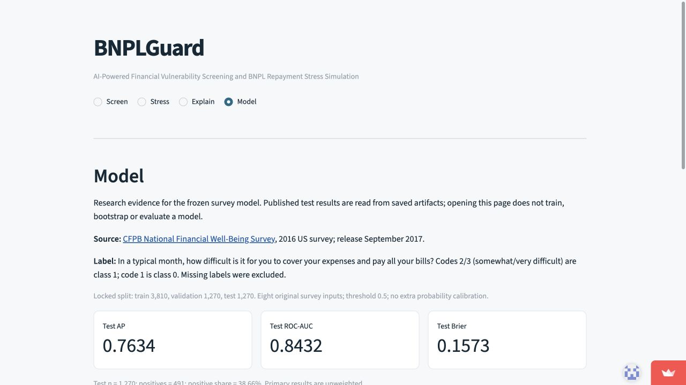

# BNPLGuard

**AI-Powered Financial Vulnerability Screening and BNPL Repayment Stress Simulation**

**[Open the public application](https://bnplguard-yixuan502.streamlit.app/)** — no login required in the verified anonymous browser workflow.

An English Streamlit research app with four areas: **Screen / Stress / Explain / Model**. Screen loads the frozen CFPB Logistic Regression Pipeline and verified local SHAP; Stress uses an independent deterministic monthly calculator. The explanation helper uses offline English templates. **LLM is disabled; no API key or external AI request is needed.** Kaggle exploratory classification remains a report appendix, outside personal screening.

## Run locally

The active desktop project is `/Users/oneone/Desktop/BNPLGuard`. In PyCharm select `/Users/oneone/Desktop/BNPLGuard/.venv/bin/python`, working directory the project root, module `streamlit`, parameters `run app.py`.

```bash
cd /Users/oneone/Desktop/BNPLGuard
.venv/bin/python -m streamlit run app.py
```

Open the URL actually printed by Streamlit (normally http://127.0.0.1:8501). Stop with **Ctrl+C** in that terminal. If the port is occupied, use the existing verified app or inspect its current process before stopping it; do not reuse an old PID.

For a fresh checkout with Python **3.13**, install [uv](https://docs.astral.sh/uv/getting-started/installation/) and use the exact committed lock:

```bash
uv sync --frozen --group test
uv run --frozen python -m streamlit run app.py
```

Alternatively create `.venv` with Python 3.13 and install `requirements-app-lock.txt`. Community Cloud uses **uv.lock** ahead of the historical requirements files. Model-compatible versions include scikit-learn 1.9.1, NumPy 2.5.4, SHAP 0.54.1 and Streamlit 1.66.1. No fitting, audit, bootstrap or full-dataset explanation runs on app startup.

## Research scope

The CFPB task is contemporaneous self-reported difficulty covering expenses and paying bills, using the US 2016 survey: ENDSMEET 2/3 versus 1. Eight categorical inputs retain their Codebook meanings; annual household USD income bands are never mapped from simulator AUD monthly income. The fixed split is 3,810 / 1,270 / 1,270; threshold **0.5**, no extra calibration. Saved final LR test AP **0.763422**, ROC-AUC **0.843158**, Brier **0.157295** are unweighted sample performance. Validation and test evidence remain separate.

Local probability overestimation, subgroup error differences, imputation and domain limits remain visible. This is not BNPL default prediction, credit approval, causal advice, Australian external validation or a compliance certification. SHAP reports contributions in **log-odds**, not probability percentage points or personal causes.

The independent simulator takes I/E/D/B0/Bnew/S in one currency, AUD by default. Necessary living expenses exclude repayments already entered separately. Its five fictional example buffers are **900 / 700 / 0 / -200 / 1100 AUD**. Positive monthly cash flow does not guarantee cash on every due date. Hypothetical repayment reductions do not modify contracts. The simulator does not change the CFPB estimate.

## Deployment and acceptance

Repository: [yixuan502/BNPLGuard](https://github.com/yixuan502/BNPLGuard), private by default. The instructor must receive repository access if code access is required. The application is public separately from the private code repository. Accepted initial deployed app revision: [`c23178c`](https://github.com/yixuan502/BNPLGuard/commit/c23178cd823ae6d70b4f2cfdb11576bad6793670). The actual remote checkout passed all four portable app checks; the public URL passed actual anonymous Screen/SHAP, Stress, Explain and Model interaction. Detailed build, preservation and acceptance evidence is in the [deployment record](docs/deployment.md).

Deployed from `main`, `app.py`, Python **3.13**, no secrets, with app Sharing set to public. Cloud logs confirm uv-sync used uv.lock. The local full suite passed **154 tests**; anonymous acceptance exercised the real UI, beyond a health check. Community Cloud can sleep/cold-start; real-user feedback remains stage nine.

The reviewed runtime file allowlist excludes raw datasets, per-record predictions, local environments, secrets, reference Notebooks, course PDFs and backups. It includes the trusted frozen model, schema, label/split reference, fixed encoded training-only SHAP background, fictional presets and aggregate evaluation evidence. These are sufficient for app inference; the complete historical research tests additionally require the local research archive. No unknown uploaded models are loaded and no personal financial inputs are logged by app code.

```bash
# Complete local research copy only:
.venv/bin/python -m pytest -q
# Portable release audit:
.venv/bin/python -m src.deployment audit
# Fresh raw-data-free checkout only:
uv run --frozen --group test python deployment/smoke.py
```

The portable smoke check exercises all four areas, exact frozen prediction/SHAP reconstruction, offline templates, simulator buffers and saved Model metrics. It is separate from actual browser/public acceptance. Original data/research artifacts are preserved locally; frozen model SHA256 is `6f8a82a70e38ae9d5f6143ca4b491d21932d480ca1b38e3d93f079c6794c06d8`.



## Documentation

Start with [project specification](docs/project_spec.md), [current progress](docs/progress.md), [model card](docs/model_card.md), [explanation addendum](docs/model_card_extensions.md), [local app acceptance](docs/stage7_app.md), [deployment packaging](deployment/README.md), [simulator method](docs/simulator_method.md), [SHAP method](docs/cfpb_local_explanation.md), [data selection decision](docs/data_source_decision.md) and [Australian official context](docs/australian_context.md).

The CFPB source/version links and raw checksum are retained in `config/app_source.json`; raw acquisition and earlier audit evidence remain in the local research archive. Third-party licenses remain separate from project code: the Kaggle page screenshot states CC0 1.0 for its dataset, not for reference Notebook code. No open-source code license is newly assigned by this deployment. AI-assisted implementation and verification are recorded in [contribution log](docs/contribution_log.md); student review and real-user research remain distinct responsibilities.


## Team handoff and research evidence

The repository now also contains final research artifacts, Kaggle appendix evidence, simulator/SHAP examples and blank English user-testing instruments; the reviewed inference runtime remains the separate99-file `deployment/runtime_files.json` subset. Start with [START_HERE](START_HERE.md), [EVIDENCE_MAP](EVIDENCE_MAP.md) and [AI_HANDOFF_PROMPT](AI_HANDOFF_PROMPT.md) (Chinese team navigation). See [repository contents and acquisition steps](docs/repository_contents.md) for deliberate exclusions and reproduction limits.

[User feedback verification](docs/user_testing_feedback_review.md) now records receipt of a three-participant compilation:16/18 text answers;18/18 recorded app answers, including12 after operational guidance. Independent app originals and S1 wording have evidence gaps; do not infer causal improvement or all-user independent success. The source workbook is private; only the aggregate review is committed. Blank instruments remain separate: participant PDF for testers, answer guide and blank results workbook for facilitators. This receipt supersedes earlier waiting-for-feedback statements; no course report has been written by this change.


## Local feedback revision — pending publication

Stress now separates monthly cash-flow entries from savings today, preserves I/E/D/B0/Bnew/S reading order in one column, and shows all five scenario cards with final buffer, change and signed status. The existing RTI/coverage/details/templates remain. Revision stress-feedback-v1 is a local change on base d67f0ba; no push/deployment occurred. See [change and acceptance record](docs/stress_feedback_changes.md), [blank English retest form](user_testing/retest_v1/retest_form.md) and [facilitator-only guide](user_testing/retest_v1/facilitator_notes.md).155tests and desktop/narrow Chrome checks passed; physical devices and real retest outcomes remain unverified. Use the local app for this revision; the public URL still reflects the published version.


## Local monthly instalment estimator

The optional purchase-plan input uses cent-exact allocation and applies the highest monthly instalment to the independent stress simulator after explicit user action. Direct input remains the default and is retained when switching modes. See docs/installment_plan.md. User retest task prepared; no participant result is implied. Changes are local and pending publication; no training, push or deployment.


## Stress and instalment release (5 November 2026)

Release marker: `stress-installments-20261105`. Updated Stress input order, savings separation, five visible scenario results and optional monthly instalment estimation. User retest forms are prepared; actual participant retest remains pending. See docs/installment_plan.md, docs/stress_feedback_changes.md and user_testing/retest_v1/. Online acceptance and actual commit must be checked separately; do not infer them from this preparation note.
