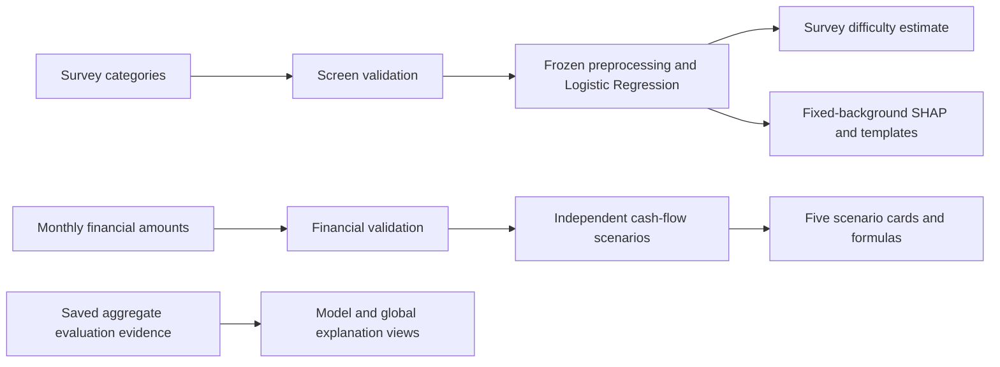

# System architecture

`app.py` delegates to `src/app_ui.py`. Input definitions are centralized in `app_inputs.py`; `app_state.py` manages independent drafts and submitted snapshots; `app_services.py` connects the frozen model, local explanations and simulator; `app_charts.py` renders their outputs. The model pipeline embeds the raw-code mapping, training-fitted imputer and one-hot encoding. Survey codes are not derived from simulator amounts.

Model/explainer resources and static evidence are cached to avoid repeatedly loading trusted files; locks protect shared resources. Personal inputs/results are not cached across users. Inference performs no training, bootstrap, recalibration or SHAP-background regeneration. This is a documented performance optimization, not a measured speed-up claim.

Changing inputs invalidates stale results. Blank, loading, result, warning and unavailable states are explicit. An explanation failure preserves a valid prediction while withholding its chart; a missing model does not block the simulator. Missing evidence is reported rather than replaced with invented values. Responsive layouts stack cards on narrow displays.

The simulator validates finite, nonnegative inputs and computes buffer, repayment-to-income and savings coverage independently of ML. Zero denominators produce explained N/A values; negative buffers remain visible. Monthly and hypothetical-contract assumptions are displayed with results. The instalment calculator allocates whole cents and applies its highest monthly payment only after explicit user action.

LLM calls are disabled. Templates use trusted structured outputs and do not calculate new model probabilities. The separate Kaggle experiment supplies no personal screening endpoint. Inputs are session-scoped; the app does not log financial inputs or execute uploaded model files.
