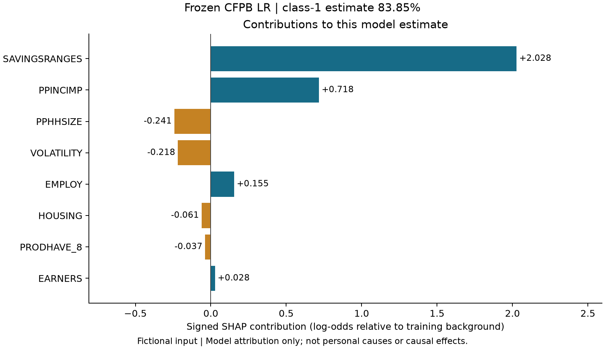

# Frozen CFPB local SHAP

Actual installed SHAP 0.54.1, LinearExplainer with maskers.Independent. No CFPB estimator was fitted or calibrated; its eight raw fields, target, split, 0.5 threshold and artifacts remain unchanged. Method reference: [SHAP LinearExplainer documentation](https://shap.readthedocs.io/en/latest/generated/shap.LinearExplainer.html).

## Reference and output space

Choose 200 rows uniformly without replacement from the locked 3,810 training IDs, seed 20261105. This is a fixed reference sample, not a claim of population representativeness. Save IDs and encoded matrix/config hashes in config/cfpb_shap_background.json and models/cfpb/explanations_v1. Validation/test rows and labels are excluded. The entire persisted preprocessing Pipeline transforms reference and input rows; no new encoder or imputer is fitted.

Verify classes=[0,1], LR coefficient shape, raw schema, persisted imputer input order, encoder categories, transformed names and one-hot-to-original mapping. Explanation concerns the positive ENDSMEET difficulty class. Output units are **log-odds**, never probability percentage points. Baseline is the mean model logit under the finite background; it is not mean predicted probability.

Independent masking uses marginal reference expectations and breaks dependence among encoded inputs, including one-hot exclusivity. Grouping the one-hot contributions into the original eight columns preserves their sum; it is not a claim of conditional or causal attribution. Background choice changes baseline/allocation. A prespecified second training-only sample, seed 20261106, is saved as a sensitivity diagnostic; it did not replace the primary background or model.

## Verification and examples

For each input, verify baseline plus encoded sum equals Pipeline decision_function; grouped sum equals encoded sum; expit(baseline plus grouped sum) equals unchanged predict_proba. Errors exceeding 1e-10 log-odds or 1e-12 probability withhold the explanation.

Four fictional examples include all-eight-missing processing. Observed maximum errors: {"encoded_additivity_absolute": 6.661338147750939e-16, "raw_group_additivity_absolute": 2.220446049250313e-16, "grouping_absolute": 4.440892098500626e-16, "probability_absolute": 1.1102230246251565e-16}. Tests also cover special missing code 98, schema/code/type errors, group mapping, no refit and exact repeated explanations. There is no ordinary-coefficient plot presented as SHAP.

The service accepts exactly the eight numeric survey-code fields (or None). Undocumented codes, booleans, string labels, infinities and extra fields are rejected; this preserves the frozen schema. It never maps AUD monthly amounts into USD annual household survey bands automatically. Missing values use the original training-mode imputation and remain flagged in the returned rows.



The title is **Contributions to this model estimate**. It explains model behavior relative to a reference, not a person's true reasons, an intervention effect or a guaranteed outcome. Stage-five validation-only Permutation Importance remains the global explanation: average AP change across validation records differs from one input's log-odds allocation. Neither method establishes causality.

Original local probability overestimation, subgroup error disparities, unweighted evaluation and population/label limits remain in the base model card. SHAP does not repair them. The unchanged base card plus model_card_extensions.md form the current documentation.

```bash
.venv/bin/python -m src.cfpb_local_explanation --output-dir outputs/explanations/pycharm_01
```

The command reuses the saved background; completed output directories are not overwritten. CSVs, one-hot mapping, checks, background sensitivity and figures are retained. Core dependencies remain pinned; requirements-extensions.txt adds SHAP/slicer/tqdm without upgrading sklearn/numpy/pandas/scipy/joblib.
