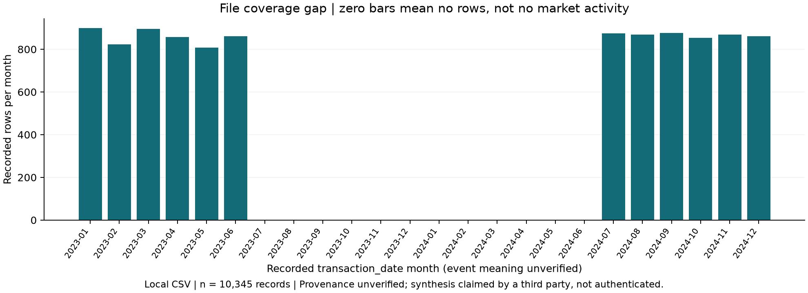
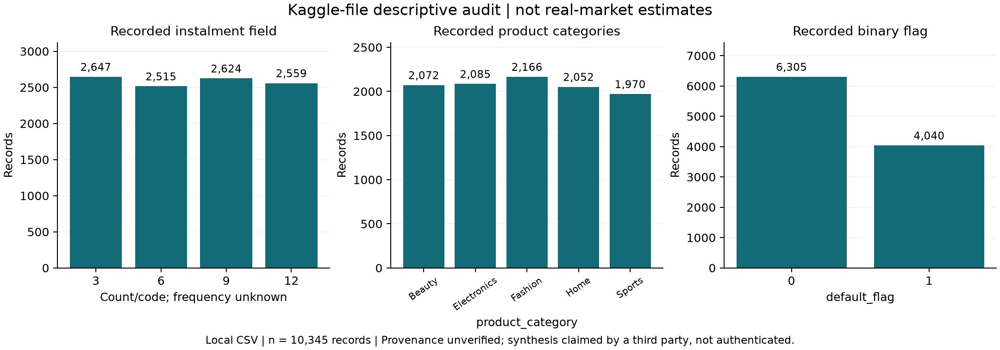

# Kaggle BNPL specialist audit

> Current supplement (5 November 2026): user page screenshots mark CC0 1.0 Public Domain, and the preserved reference Notebook is now directly reviewed. See kaggle_notebook_review.md, kaggle_experiment.md and data_source_decision.md. The original audit below is retained as dated evidence; its license-unknown/defer-only status is superseded by this supplement, while its timing/semantic limits remain.

Completed 5 November 2026, after core stage 6 and before stage 7. **Decision C: defer second-source modeling and exclude it from the current application. Proceed to stage 7 using the existing CFPB model and simulator.** Local audit EDA is retained as an appendix/methodology artifact only.

## Scope and preserved work

Used /Users/oneone/Desktop/BNPLGuard/.venv/bin/python. Read AGENTS/spec/progress and prior registration; reread the actual CSV rather than treating old counts as new checks. No new CSV, model training, cross-source join, Australian evidence, Streamlit or LLM work. The existing CFPB model/schema/label/split/threshold/evaluation and simulator were protected by a 157-file hash snapshot and remain unchanged, including the model card and existing tests/source. The local original CSV was not edited, moved or redownloaded.

Source: data/raw/kaggle_bnpl/Buy_Now_Pay_Later_BNPL_CreditRisk_Dataset.csv. Size 1,170,187 bytes. SHA256 **780cdb1eec43519b0764059563d89258ef1d9e4cef3b1ffdeab9622d6976b1bd**. This is the audited local version, not a verified Kaggle version number.

## Evidence classes and source confidence

- **Local verified facts:** file shape, types, IDs, dates, distributions, bounds and arithmetic equalities below.
- **Publisher statements:** no readable first-party card or current Notebook cells obtained; public requests returned 404 and the web reader exposed at most titles. This is an access gap, not proof a source never existed.
- **External auxiliary claim:** a GitHub project explicitly links the supplied Kaggle URL and calls the dataset synthetic; this is attributed third-party evidence, not authenticated origin or generation code.
- **Unknown:** publisher version/license, actual collection source, synthesis status/method, common currency, income scope/period, repayment schedule, default rule/window and field availability at application time.

Full URLs, dates, HTTP attempts, saved auxiliary text and historical-Notebook limits: [source evidence](kaggle_sources.md). Similar filenames and unrelated dataset descriptions were not used to fill these gaps. No external model metric was adopted.

## Quality and observed grain

| Check | Actual result | Implication |
|---|---:|---|
| Rows / fields |10345 /17| Matches the previous registration after an actual new read |
| Standard missing / blank strings |0 /0| Does not establish semantic completeness |
| Exact duplicate rows |0| No duplicate rows removed |
| Repeated/missing user_id |0 /0| One row per recorded ID, not proof of unique real people |
| ID pattern |1..10345 in order| An identifier pattern, not proof of synthesis |
| Numeric / string columns |12 /5| Full profile saved |
| Finite / negative numeric values |All finite /0 negative| No automatic error repair |
| Recorded flag 1 |4040 /10345 =39.0527%| File-level flag frequency only, not industry default rate |

Every ID has one row; there are no observed within-user histories. **Semantic grain remains unknown**: one row could be a user snapshot or one modeled transaction per user; the presence of transaction_date does not resolve it. No transaction/contract/application ID or repeated repayment ledger was identified. The third-party transaction description is a claim rather than verification.

Possible sentinel search covers missing-like tokens and selected numeric codes. user_id 999/9999 are ordinary members of the sequential identifier sequence, not inferred missing values. Zero scores/counters may be legitimate; no source codebook authorizes recoding. All raw values are retained.

## Time coverage

All 10345 date strings parse as YYYY-MM-DD. Earliest 2023-01-01, latest 2024-12-31, but only 365 distinct dates are represented. Rows occur in **Jan–Jun 2023 and Jul–Dec 2024**, with no records for **Jul 2023–Jun 2024** (12 consecutive months). The overall min/max range is therefore not continuous observational coverage. No outcome/as-of or follow-up date is provided. Do not infer market seasonality, absence of real transactions, or application-time predictability from these timestamps.



## Ranges, concentrations and categories

Recorded numeric ranges, in their **unverified raw units**:

| Field | Range / notable concentration |
|---|---|
| age |18–59; years suggested by name only|
| monthly_income |5000–145767.12; currency, tax basis and monthly semantics unverified|
| credit_score |300–850;1373 at 300; provider/country comparability unknown|
| purchase_amount |100–5000;6053(58.51%) at 5000 and 263 at 100|
| bnpl_installments |3,6,9,12;2647/2515/2624/2559 rows; count role/frequency unknown|
| repayment_delay_days |0–33;1219 zero; event/window undefined|
| missed_payments |0–7;3704 zero; count/window undefined|
| app_usage_frequency |1–10 including decimals; visits/index/window unknown|
| debt_to_income_ratio |.000811–.723460; equals purchase/income numerically|
| risk_score |0–398;9 zero; arithmetic dependency below|

IQR screening flags 25 income values, 1 delay value, 8 missed-payment counts, 57 ratio values and 31 scores. These are **exploratory distribution flags**, not validated errors or exclusion rules. Values concentrated at bounds are compatible with clipping, constraints or construction, but no publisher method was authenticated. No outlier was deleted. Regularity alone does not prove synthesis.

There are 4 employment categories, 5 product categories and 6 location labels(Australia/Canada/Germany/India/UK/USA). No common currency or conversion basis is documented. No cross-country monetary mean comparisons were performed. A label of Australia does not establish AUD units or make the file Australian external validation.



Charts show record counts and recorded values, explicitly **Provenance unverified**. They do not claim real market shares or authenticated Synthetic data. Source identity and synthesis are not strengthened by plotting.

## Labels, dependencies and leakage

Default flag has 0/1 values but no verified default threshold, reference obligation, observation window, maturity rule or censoring scheme. There is no evidence that any behavioral field is an application-time historical measure. Both label classes coexist in all inspected diagnostic bins/segments. 325 flag 1 rows have zero recorded delay and misses; this is a specification question, not a justified relabel/delete rule.

All 10345 rows numerically satisfy purchase/income for the DTI-named field and .4*(850-credit_score)+2*delay+20*misses for risk_score. These are observed arithmetic equalities, not authenticated generation formulas. risk_score inherits repayment-state timing risk. customer_segment's labels and generation rule are unverified and must not be treated as calibrated risk classes. Detailed field/time/label/risk/use table: [leakage review](kaggle_leakage_review.md); [field dictionary](kaggle_data_dictionary.md); machine-readable field_leakage_review.csv.

The original Notebook page and source could not be obtained. Three earlier local expressions are reviewed conditionally, without asserting correspondence to the current online Notebook: income/(instalments+1), delay/(instalments+1), and calendar month. None establishes monthly repayment or a prospective target. Other derivatives and current preprocessing code remain unverified. No high-score classifier was fitted to justify these fields.

## Simulator compatibility and incremental value

| Simulator input | Kaggle support | Required treatment |
|---|---|---|
| After-tax monthly I | monthly_income name only; currency/tax/period/scope unverified | Do not autofill |
| Necessary living E | Absent | Must be explicit fictional/user assumption, never observed |
| Non-BNPL monthly repayment D | Absent; DTI-named field is purchase/income | Do not reverse-engineer D |
| Existing monthly BNPL B0 | No repayment amount or dated schedule | Cannot derive from misses/delay |
| Proposed monthly Bnew | purchase_amount and instalment count role/frequency unknown | purchase/count is not an observed monthly repayment |
| Emergency savings S | Absent | Explicit assumption only, not observed |
| Currency | Country labels only | No implicit location-to-currency mapping or FX conversion |

A fully hypothetical schedule and assumed E/D/S could be stated explicitly, but then the key cash-flow inputs would not be observations from this source. The existing stage-six fictional example already supplies a clearer, auditable demonstration. No mixed observed/assumed financial example was created here to imply extra validation. Recorded product/count categories offer only limited optional appendix illustration; they add no verified target, repayment amounts or external-validity evidence to the core application.

## Adoption and execution

Recommendation and re-entry criteria: [data_source_decision.md](data_source_decision.md). **C, deferred/excluded from current application**, rather than A as a deployed EDA module or B as an immediate independent classifier. The audit itself can support honest discussion of provenance and leakage. Proceed to stage 7; no extra experiment blocks the core deliverable.

```bash
cd /Users/oneone/Desktop/BNPLGuard
.venv/bin/python -m src.kaggle_audit --verify-only
.venv/bin/python -m pytest -q tests/test_kaggle_audit.py
# Recompute local checks/plots from existing CSV and saved evidence in a new directory:
.venv/bin/python -m src.kaggle_audit --output-dir outputs/kaggle_audit/reproduce_01
```

Four focused audit checks passed. The project-mandated full regression suite also passed: **115 tests in 4.57s** (the previous 111 cases plus four audit checks). The existing CFPB data-audit gate passed, and its regenerated audit outputs were byte-identical to the saved versions. No model or simulator code changed. The 157-file protected snapshot proves those sources, tests, model artifacts, configurations, datasets, evaluation results, simulator exports and model card are unchanged. Both charts were visually inspected. Model training remains false in the manifest. Initial exploratory profiling exports were preserved separately, including clarification that the DTI-named arithmetic has no verified currency/time dimension. The current v1 directory is the final handoff and completed directories are protected.
