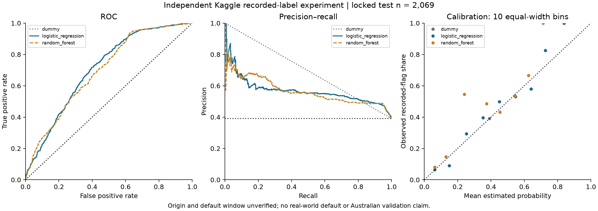
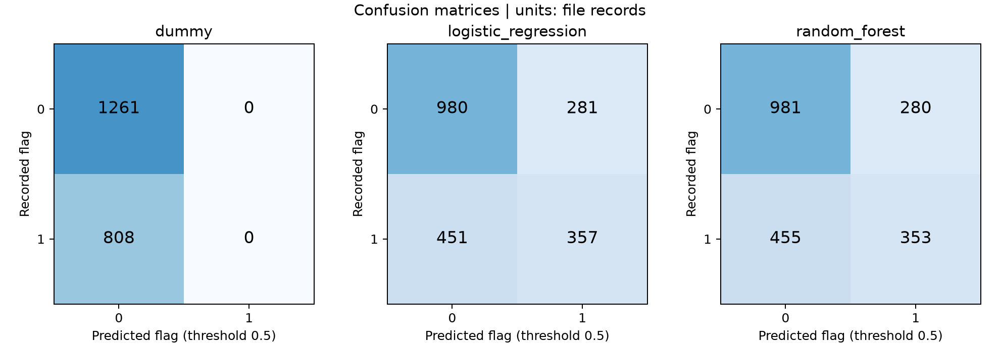

# Independent Kaggle recorded-label experiment

Completed 5 November 2026. Objective: **Exploratory classification of the recorded default_flag label in the Kaggle dataset.** Presentation decision: **2 — report appendix only**, with no personal prediction interface or default application tab.

## Source, cleaning and interpretation

The existing CSV remains byte-identical: SHA256 780cdb1eec43519b0764059563d89258ef1d9e4cef3b1ffdeab9622d6976b1bd. Fresh checks retain 10,345 records and 17 fields, no standard missing values, duplicate rows or duplicate user IDs. IDs occur once per record; real-person/transaction grain remains unauthenticated. The label has 6,305 zeros and 4,040 ones (39.0527%); this is a file frequency, not an industry default rate. Parse failures/nonbinary labels stop the experiment; missing labels would be excluded and logged, never changed to zero. No row was dropped, clipped, relabeled or removed as an outlier in this experiment. Sample flow is saved separately.

All recorded dates parse, but rows occur only in January–June 2023 and July–December 2024. The twelve-month gap persists; min/max is not continuous market history. The prior quality audit remains reproducible under outputs/kaggle_audit/v1.

The new page screenshots state **CC0 1.0 Public Domain** and match the headline counts. They do not resolve synthesis, default standards/window, currency, payment frequency or timing. Notebook datasetVersion sourceId 15502327 does not certify CSV bytes. See [supplement review](kaggle_notebook_review.md) and data/metadata/kaggle_supplement_v2.json. A third-party synthetic claim remains auxiliary; primary synthesis status is unconfirmed. Existing historical audit records were retained.

## Fixed predictors and preprocessing

Ten predictors: age, monthly_income, credit_score, purchase_amount, app_usage_frequency, debt_to_income_ratio, employment_type, product_category, location, bnpl_installments. Numeric median filling/scaling and categorical mode filling/one-hot encoding live inside a ColumnTransformer/Pipeline. bnpl_installments is categorical because its count/period semantics are uncertain. Unknown categories use OneHotEncoder(handle_unknown=ignore); no nominal label encoding. No predictor is certified available before an application. Credit-score system, DTI meaning, app-use window and monetary units remain unknown. Numerically valid fields are used only as file-contained predictors. The DTI-named value is redundant with purchase/income; it is not claimed to be a validated debt-service ratio.

Excluded: user_id; repayment_delay_days; missed_payments; risk_score; customer_segment; their derived variables; transaction_date; target default_flag as a predictor. No reconstructed cash flow, savings or monthly BNPL payment. The full schema/rationale is config/kaggle_feature_schema.json.

## Sealed design and development selection

config/kaggle_experiment.json was saved before fitting. Seed 42, stratified 60/20/20: training 6,207, validation 2,069, locked test 2,069. Each split has 39.0527% label 1; counts are 2,424/808/808 respectively. IDs are saved in data/splits/kaggle_split_ids_v1.json and are mutually disjoint. This is a within-file exchangeable-record design, not time-based future prediction. Unobserved related groups cannot be ruled out.

Four-fold shuffled training CV fits every learned preprocessing step within its training fold. LR C=0.1/1/10; RF 200 trees, depth 6/unbounded, minimum leaf 10/30; Dummy prior. Family candidates use maximal mean CV AP with declared tie order. Validation selection keeps candidates within 0.01 AP of the best, then within 0.005 Brier of the eligible minimum, then prefers Dummy/LR/RF complexity order. No optional calibration search; fixed threshold 0.5. Models fit training only, without train+validation refit.

| Model | Validation AP | Validation ROC-AUC | Validation Brier | Training AP | Train minus validation AP | CV AP SD |
|---|---|---|---|---|---|---|
| dummy | 0.390527 | 0.500000 | 0.238016 | 0.390527 | 0.000000 | 0.000109 |
| logistic_regression | 0.524994 | 0.687733 | 0.212156 | 0.554978 | 0.029984 | 0.011917 |
| random_forest | 0.529174 | 0.687743 | 0.206755 | 0.921401 | 0.392227 | 0.010979 |

The frozen selection is **random_forest**, parameters {"n_estimators": 200, "max_depth": null, "min_samples_leaf": 10}. LR selected C=10. RF won the prespecified Brier eligibility filter: LR minus RF validation Brier is approximately 0.005400, narrowly beyond the 0.005 tolerance. RF validation AP exceeds LR by only 0.004180 and its training AP is 0.921401 versus validation 0.529174. This large generalization gap is material overfitting evidence; training performance is not deployment value. CV SDs are finite-fold descriptive stability evidence, not complete process uncertainty. The selection is protocol-dependent, not proof RF is generally superior.

The artifacts and exact parameters were written to models/kaggle/exploratory_v1/frozen.json before test scoring. The freeze receipt protects development results, code, schema, split and artifacts. Test results did not alter the selected family, threshold, calibration or parameters.

## Locked test results

Same 2,069 records for all three prespecified models: 808 positives, 1,261 negatives. Threshold 0.5 for every classification metric; main metrics are unweighted file-record results.

| Model | Accuracy | Precision | Recall | F1 | ROC-AUC | AP | Brier |
|---|---|---|---|---|---|---|---|
| dummy | 0.609473 | N/A | 0.000000 | 0.000000 | 0.500000 | 0.390527 | 0.238016 |
| logistic_regression | 0.646206 | 0.559561 | 0.441832 | 0.493776 | 0.707620 | 0.568170 | 0.207157 |
| random_forest | 0.644756 | 0.557662 | 0.436881 | 0.489938 | 0.697078 | 0.566320 | 0.206394 |

Dummy Precision is N/A because it predicts no positives; Recall and F1 are zero with observed positives. Full reasons and confusion counts are in test_metrics.json. RF confusion counts TN/FP/FN/TP are 981/280/455/353; LR counts are 980/281/451/357. The selected RF remains selected even though LR's test AP/AUC point estimates are higher. Cross-task CFPB scores must not be ranked against these results.





## Uncertainty and probability reliability

| Model | Metric | 95% lower | 95% upper | Valid draws |
|---|---|---|---|---|
| dummy | roc_auc | 0.500000 | 0.500000 | 1000 |
| dummy | average_precision | 0.369261 | 0.411322 | 1000 |
| dummy | brier | 0.233359 | 0.242569 | 1000 |
| logistic_regression | roc_auc | 0.685759 | 0.729036 | 1000 |
| logistic_regression | average_precision | 0.531472 | 0.605428 | 1000 |
| logistic_regression | brier | 0.199906 | 0.214181 | 1000 |
| random_forest | roc_auc | 0.673686 | 0.719352 | 1000 |
| random_forest | average_precision | 0.529945 | 0.607461 | 1000 |
| random_forest | brier | 0.199429 | 0.213437 | 1000 |

One thousand unstratified record bootstrap draws, seed 20261105, shared across models. Percentile 2.5/97.5 limits; undefined draws are skipped and counted per metric, with at least 90% required for an interval. Dummy Precision has no valid draws and no interval. Draw indices and per-draw values are saved. These intervals describe fixed-model sampling uncertainty over this file's test records; they exclude retraining, model selection, source construction, unknown dependence and real-market transport uncertainty.

Paired LR-minus-RF 95% intervals include zero: AP [-0.027817, 0.028734], AUC [-0.005752, 0.026905], Brier [-0.003402, 0.004771]. Small point differences do not establish a significant advantage. No test-driven reselection occurred.

Calibration uses ten equal-width bins in [0,1], with empty bins retained in the CSV and n<30 flagged. Extreme-bin estimates can be dominated by very few records. Brier is a proper prediction-error measure; its lower value does not by itself establish adequate calibration. The raw probabilities are not verified real-world default probabilities. No test-label recalibration or threshold optimization.

## Adoption and reproduction

The experiment adds a transparent example of disciplined second-source research and the effect of excluding outcome-like fields. It does not solve source semantics or add validated Australian behavior, CFPB external validation, simulator inputs, causal effects or lending decisions. Keep it as a report appendix; no personal Kaggle scoring endpoint, probability averaging, cross-source join or unified risk score. See [Kaggle model card](kaggle_model_card.md).

```bash
cd /Users/oneone/Desktop/BNPLGuard
.venv/bin/python -m src.kaggle_experiment --phase verify
```

For deliberate reproduction only, preserve the existing run and reuse the locked IDs:

```bash
.venv/bin/python -m src.kaggle_experiment --phase train --run-dir models/kaggle/reproduce_01 --output-dir outputs/kaggle_experiment/reproduce_01
.venv/bin/python -m src.kaggle_experiment --phase evaluate --run-dir models/kaggle/reproduce_01 --output-dir outputs/kaggle_experiment/reproduce_01
```

These commands rerun the sealed experiment, not a search for improved test results. Formal outputs, predictions, calibration counts, bootstrap draws, figures and manifests live under outputs/kaggle_experiment/v1; model artifacts are independent of CFPB.
