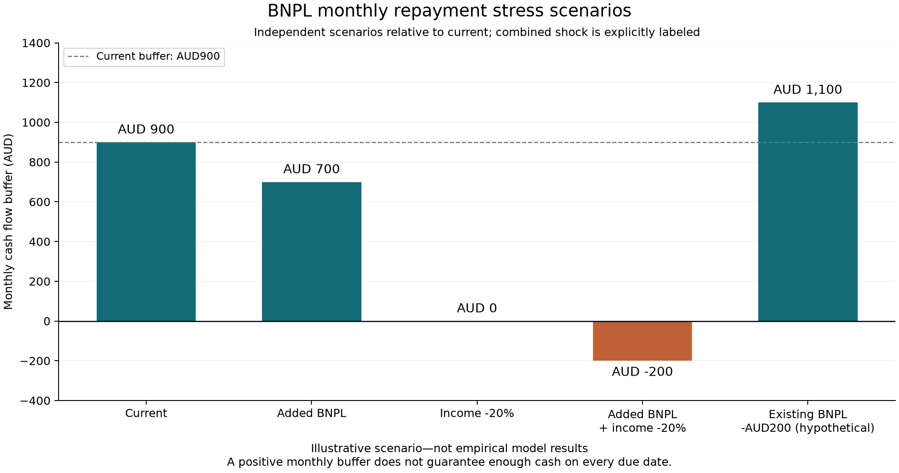

# Monthly BNPL repayment stress simulator

Stage 6 completed on 4 November 2026. The module is a deterministic financial calculator. It imports no model, dataset, pandas, numpy, sklearn or joblib; standalone use is tested with site packages disabled. Stage-five model limits remain in the unchanged model card and in the risk register. Streamlit integration has not begun.

## Inputs and financial definitions

| Field | Meaning | Unit |
|---|---|---|
| I | Monthly after-tax income | Currency per month |
| E | Necessary monthly living expenses, excluding all repayments already entered below | Currency per month |
| D | Existing monthly non-BNPL debt repayments only | Currency per month |
| B0 | Existing monthly BNPL repayments only | Currency per month |
| Bnew | Proposed additional monthly BNPL repayments | Currency per month |
| S | Accessible emergency savings, not a recurring income flow | Currency stock |

All amounts must use the **same currency**, default AUD. The optional currency label is three alphabetic characters, normalized to uppercase; it is a label, not a currency-conversion service or validation of every ISO code. Switching the label leaves all arithmetic amounts unchanged. The caller is responsible for using one actual currency consistently. These monetary amounts never map automatically to CFPB household USD survey categories.

E must exclude D/B0/Bnew, and D must exclude BNPL. The calculator cannot detect that a user has entered the same real-world repayment twice; future form labels and examples must make this accounting convention explicit. S must be money available for the assumed outflows, not a total illiquid asset value.

```
B = B0 + Bnew
Monthly Cash Flow Buffer = I - E - D - B
Repayment-to-Income Ratio = (D + B) / I
Emergency Savings Coverage = S / (E + D + B)
```

RTI is a ratio in core results and a percentage in the display layer; its change is displayed in **percentage points**, never as a relative percentage change. Coverage is months of savings under **no new income** and unchanged expenses/repayments. It is not the user's actual funds-depletion time when income continues, and the module does not deplete S over a sequence of months.

## Five explicitly defined scenarios

Every scenario derives from an immutable current-case input. Proposed Bnew is excluded from current. There is no accidental chaining between scenario calculations.

1. **Current:** I/E/D/B0/S unchanged; Bnew=0.
2. **Added BNPL:** current plus submitted Bnew; income unchanged.
3. **Income shock:** current income multiplied by (1-income_drop); Bnew=0.
4. **Added BNPL + income shock:** apply both changes relative to current. This is the only explicitly combined shock.
5. **Reduced existing BNPL:** current B0 minus bnpl_reduction; I unchanged, Bnew=0. This is a user-defined hypothetical, not permission to change contractual obligations.

income_drop is a **fraction from0 to1**, inclusive:0.2 means20%,1 means100%. A future percentage slider must divide its value by100 before passing it to this API. bnpl_reduction must be a nonnegative same-currency amount no greater than B0. The default reduction is0; the supplied demonstration explicitly uses200. Shock/reduction choices are assumptions, not forecasts, approvals or regulatory risk thresholds.

Each scenario includes the effective inputs, full assumptions, actual applied changes, metrics, scenario-minus-current metric deltas, English messages and separate formatted display values. A delta is N/A whenever its scenario or current metric is N/A, rather than inventing a zero change.

## Validation and API responses

src/input_validation.py performs type/range checks. It accepts finite nonnegative integer, float, Decimal and Fraction numeric values (including legitimate zeros); numeric strings, booleans, complex values, missing/unknown fields and nonfinite/negative values are rejected with field-specific errors. It validates settings and the one currency label separately. Input payloads are never mutated.

src/bnpl_simulator.py contains immutable typed inputs, exact rational formulas, five independent scenarios and deltas. src/simulator_presentation.py provides run_simulation, JSON-safe serialization, formatted text and auditable English rule messages. This separation allows a later Streamlit UI to import the interface without changing financial formulas or importing ML.

| Status | Meaning |
|---|---|
| ok | Valid inputs and all scenario metrics defined. Negative cash flow is a valid calculation with a rule message, not an input error. |
| partial | Inputs are valid but at least one actual metric is unavailable; defined metrics are still returned. |
| invalid_input | Field-specific validation errors; no scenario results are generated. |

Every metric has status, value, unit and reason. For I=0, cash flow is still calculated and RTI is unavailable with a reason. For E+D+B=0, Coverage is unavailable with a reason. S=0 with positive outflows yields Coverage0, and zero repayments with positive income yield RTI0. Missing deltas have their own reasons. Display text is N/A only for unavailable metrics.

Computation uses exact Fractions, converting decimal-like numeric inputs through Decimal(str(value)) rather than inheriting binary-float representation error. Wire values are **decimal strings rounded to28 significant digits**, or null for unavailable values, so even very large ratios cannot produce JSON Infinity/NaN. The exact typed results remain available from calculate_monthly/compare_scenarios. The display layer rounds money to two decimals, RTI to two percentage decimals and Coverage to three; displayed rounding never changes the underlying calculation. Very small nonzero quantities may round to zero in display text. Do not feed the returned strings back as numeric inputs without explicit parsing in a caller.

Rule templates describe negative cash flow, zero buffer, zero income, zero outflows and hypothetical repayment reductions. No low/medium/high risk cutoffs, default probability, lending approval/refusal or safe borrowing limit is returned. The general API does not write files or log real personal inputs. Only the fictional demo command exports its hardcoded example.

## Executed example

**Illustrative scenario—not empirical model results**

Fictional inputs: I4500, E2500, D700, B0400, Bnew200, S1000; currency AUD. Income drop20%; hypothetical B0 reduction200.

| Scenario | Cash buffer (AUD) | Change from current (AUD) | RTI | Coverage (months) |
|---|---:|---:|---:|---:|
| Current | 900 | 0 | 24.44% | 0.278 |
| Added BNPL | 700 | -200 | 28.89% | 0.263 |
| Income shock | 0 | -900 | 30.56% | 0.278 |
| Added BNPL + income shock | -200 | -1100 | 36.11% | 0.263 |
| Reduced existing BNPL | 1100 | 200 | 20.00% | 0.294 |

Current RTI=1100/4500=24.444…%; current Coverage=1000/3600=0.277777…months. Adding Bnew200 reduces the buffer by exactly200; a separate20% income drop reduces it by900; the explicitly combined case reduces it by1100. Reducing existing BNPL by200 raises the buffer by200 under that hypothetical assumption. Savings coverage is unchanged by income alone because its definition assumes no new income.



The CSV contains all six metrics, their deltas/reasons, effective inputs and assumptions. The JSON includes the complete structured response and messages. The original first export was preserved as stage6_demo_initial when the RTI-delta label was clarified to percentage points; financial results did not change. stage6_demo_v1 is the saved demonstration export.

## Calling from a future UI

```python
from src.simulator_presentation import run_simulation

result = run_simulation(
    dict(I=4500, E=2500, D=700, B0=400, Bnew=200, S=1000, currency='AUD'),
    income_drop=0.2,
    bnpl_reduction=200,
)
# Handle invalid_input by displaying result['errors'] next to the relevant fields.
# For valid inputs render each metric's display text/reason and the assumptions.
for scenario in result['scenarios']:
    print(scenario['title'], scenario['display']['cash_buffer']['text'])
```

```bash
cd /Users/oneone/Desktop/BNPLGuard
.venv/bin/python -m pytest -q tests/test_simulator.py
.venv/bin/python -m pytest -q
# Use an output directory that does not already exist:
.venv/bin/python -m src.simulator_demo --output-dir outputs/simulator/pycharm_demo_01
```

PyCharm interpreter: /Users/oneone/Desktop/BNPLGuard/.venv/bin/python. Working directory: the project root. No new dependency or model/data download is needed. Completed demo directories are protected; use a new name for another export. Direct API calls are repeatable and do not write anything.

## Test and preservation evidence

**87 new simulator tests;111 tests passed in3.40 seconds in the final complete run.** Boundary checks include all monetary fields, zeros, invalid types and booleans, negative/nonfinite values, full income loss, reduction>B0, absent/unknown inputs, all-zero denominators, repeated results and immutable inputs. Two hundred seeded legal cases verify monotonic cash-buffer behavior and scenario isolation. Decimal cancellation and extreme finite float cases verify exact internal arithmetic and nonfinite-safe output. A subprocess without site packages proves standalone calculation. RTI change units are explicitly tested.

The full suite includes the existing24 statistical/model tests. The119 pre-existing protected model/data/config/evaluation files and model card retain their SHA256. Frozen LR, eight features, label, split, threshold, calibration decision and all prior evaluation artifacts are unchanged. Stage-five local probability overestimation and age/income error differences remain limitations, not reasons to change the model in this stage. The English chart was opened and checked against the table.

## Limits and stage-seven readiness

This is a monthly aggregate, not a dated cash ledger. Positive monthly buffer does not guarantee sufficient cash on each due date. No payment calendar, fees/interest engine, amortization, purchase-frequency conversion, future forecasts or multi-month depletion is implemented. Values are assumed constant within each scenario, and changing B0 is a hypothetical calculation rather than a change to a contract.

There is **no technical blocker to stage7 Streamlit integration**. The UI must preserve financial input definitions, currency/percentage units, partial/error states, unchanged model limitations and separation between ML scores and scenario formulas. Formula correctness does not answer RQ2: comprehension improvement still needs real user research. Kaggle remains an unaudited later extension; no Kaggle modeling, Australian expansion, full webpage or LLM was started.
