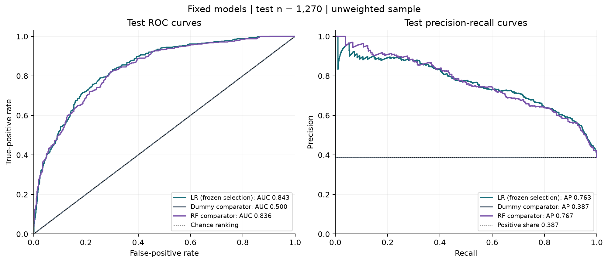
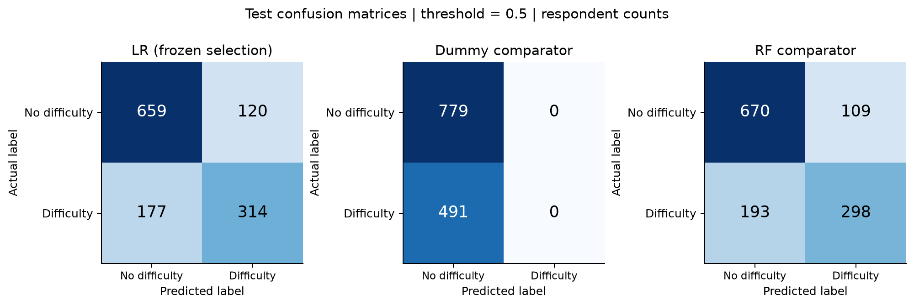
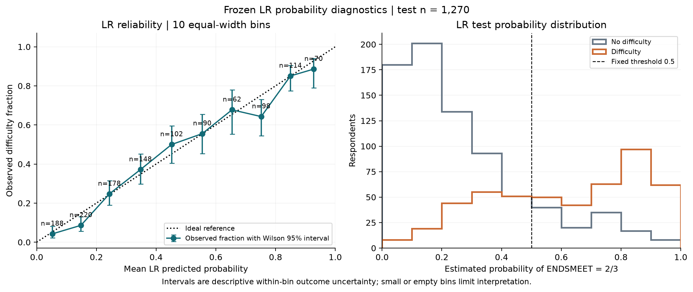
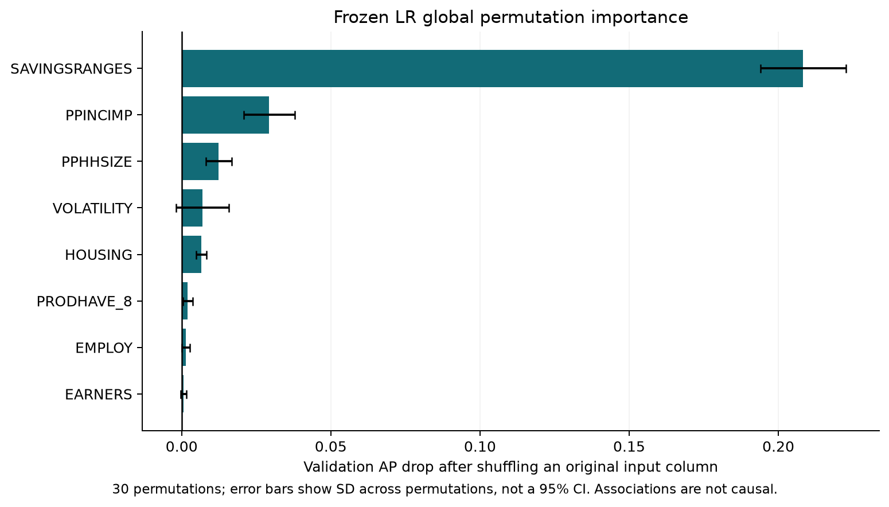

# Stage 5: frozen-model test evaluation and reliability

Completed 4 November 2026 in the desktop project using its .venv. The frozen **raw Logistic Regression**, eight inputs, main label and threshold0.5 were retained. Dummy and raw RF were declared before test scoring as descriptive comparators. There was no new model fit, calibration, threshold search or selection. Stage-four records and the immutable deployment artifacts are preserved.

## Protocol and preflight

Read AGENTS/spec/progress/selection/freeze, then declared config/stage5_evaluation.json and docs/stage5_protocol.md. The pretest checkpoint seals the evaluation source and plan hashes before test scoring. Model/data/schema/label/split hashes, all three pairwise-disjoint ID sets, training-only imputer modes and one-hot categories, frozen model parameters and original training/preprocessing source hashes were checked. The stored preprocessing matches the original training rows. A monkeypatched no-fit acceptance check also passed. This supports the recorded workflow's training-only preprocessing; it is not a claim that every conceivable upstream survey bias is absent.

All 1,270 locked test IDs are present once in test_predictions.csv, in their saved order, for every model. Positives491, negatives779, positive share38.6614%. Train3810 and validation1270 remain unchanged. The target is self-reported typical-month expense/bill difficulty: ENDSMEET2/3 positive,1 negative. No adverse test observation was removed.

## Actual test metrics

| Model | Accuracy | Precision | Recall | F1 | ROC-AUC | AP | Brier |
|---|---:|---:|---:|---:|---:|---:|---:|
| Logistic Regression (frozen) | 0.766142 | 0.723502 | 0.639511 | 0.678919 | 0.843158 | 0.763422 | 0.157295 |
| Dummy (prespecified) | 0.613386 | N/A | 0.000000 | 0.000000 | 0.500000 | 0.386614 | 0.237144 |
| Random Forest (prespecified) | 0.762205 | 0.732187 | 0.606925 | 0.663697 | 0.836302 | 0.766896 | 0.166682 |

All classification metrics use0.5; there is no optimized cost or business cutoff. Dummy precision is N/A because no positives are predicted, not a valid zero. Undefined-metric reasons are recorded in JSON. AP means average precision, not trapezoidal PR-AUC.

LR TN/FP/FN/TP=659/120/177/314. Dummy=779/0/491/0. RF=670/109/193/298. All confusion matrices are in respondent counts. The selected object remains LR even where another comparator has a higher individual test score.





## Fixed-model uncertainty

Ordinary iid bootstrap, respondent as unit,2000 draws of1270 rows with replacement, seed20261104. The same index draw is used for all three models, allowing paired differences. Percentile endpoints are2.5%/97.5%. These condition on fixed fitted models and the empirical test distribution; they omit model-training/search/selection uncertainty, complex sampling/weighting, self-report measurement error and external transportability. They are not full population survey-design intervals. Test positive prevalence is allowed to vary between draws.

| Model | Metric | Point | 95% percentile interval | Valid draws |
|---|---|---:|---|---:|
| Logistic Regression (frozen) | average_precision | 0.763422 | [0.725172, 0.802343] | 2000 |
| Logistic Regression (frozen) | roc_auc | 0.843158 | [0.821062, 0.864214] | 2000 |
| Logistic Regression (frozen) | brier | 0.157295 | [0.145968, 0.168581] | 2000 |
| Logistic Regression (frozen) | recall | 0.639511 | [0.596038, 0.681633] | 2000 |
| Logistic Regression (frozen) | f1 | 0.678919 | [0.643457, 0.712873] | 2000 |
| Dummy (prespecified) | average_precision | 0.386614 | [0.359843, 0.413406] | 2000 |
| Dummy (prespecified) | roc_auc | 0.500000 | [0.500000, 0.500000] | 2000 |
| Dummy (prespecified) | brier | 0.237144 | [0.231059, 0.243233] | 2000 |
| Dummy (prespecified) | recall | 0.000000 | [0.000000, 0.000000] | 2000 |
| Dummy (prespecified) | f1 | 0.000000 | [0.000000, 0.000000] | 2000 |
| Random Forest (prespecified) | average_precision | 0.766896 | [0.729881, 0.803404] | 2000 |
| Random Forest (prespecified) | roc_auc | 0.836302 | [0.813723, 0.859279] | 2000 |
| Random Forest (prespecified) | brier | 0.166682 | [0.158412, 0.175009] | 2000 |
| Random Forest (prespecified) | recall | 0.606925 | [0.563314, 0.649242] | 2000 |
| Random Forest (prespecified) | f1 | 0.663697 | [0.625847, 0.698380] | 2000 |

All major metrics have2000 valid draws here. Dummy precision has0 valid/2000 undefined draws and therefore no interval. The implementation also handles one-class resamples: AUC needs both classes; AP/recall need positives; FPR needs negatives; precision needs predictions; F1 requires a nonzero denominator. Counts are retained per metric, and fewer than90% finite draws would yield N/A rather than an invented interval. No such major-metric failure occurred.

| LR minus comparator | Metric | Difference | Paired 95% interval |
|---|---|---:|---|
| dummy | average_precision | 0.376808 | [0.342229, 0.413180] |
| dummy | roc_auc | 0.343158 | [0.321062, 0.364214] |
| dummy | brier | -0.079849 | [-0.091448, -0.068207] |
| random_forest | average_precision | -0.003474 | [-0.015864, 0.009062] |
| random_forest | roc_auc | 0.006855 | [-0.000214, 0.013582] |
| random_forest | brier | -0.009387 | [-0.014105, -0.004594] |

RF's AP exceeds LR by .003474 on this test set, but the paired AP interval includes zero. The paired AUC interval also includes zero. LR's Brier difference from RF is negative throughout its interval, supporting lower fixed-model squared probability error under this bootstrap method. This is not causal evidence or permission to reopen selection; differences across several reported metrics are not adjusted for multiplicity. LR clearly exceeds Dummy's AP/AUC and has lower Brier under the same fixed-model analysis. Dummy's AUC interval[.5,.5] reflects a constant-score baseline, not general certainty about model performance.

## Validation versus test

LR validation AP=.720857 → test AP=.763422; ROC-AUC=.816946 → .843158; Brier=.167396 → .157295; accuracy=.766142 in both partitions. Recall=.637475 → .639511 and F1=.678223 → .678919. No descriptive deterioration is apparent for the frozen LR. The complete deltas for all three models are saved. This is not proof of improvement across populations: validation was used for selection, and the two partitions are finite samples. No test result changed the model, threshold or calibration.

## Probability reliability

Ten prespecified equal-width bins, [0,.1), ..., [.9,1], using the mean forecast and observed difficulty fraction per bin. Counts are188,220,178,148,102,90,62,98,114,70. All bins are occupied and exceed the prespecified n30 flag, but the smallest bins still have substantial outcome uncertainty. Wilson95% intervals describe the observed bin fractions, not the model's entire calibration uncertainty; they are unadjusted across bins. Exact edges/counts/positives/intervals are in lr_calibration_bins.csv.

Mean prediction=.401084 versus observed prevalence=.386614: aggregate overestimation1.447 percentage points. In the .1–.2 bin, mean predicted=.1483 versus observed=.0864 (n220); in .7–.8, .7519 versus .6429 (n98). Other regions are closer, such as .5–.6 (.5546 versus .5556). The binned absolute gap=.03134 depends on bin boundaries and sampling; it is not a hypothesis test or calibration certificate. Local overestimation remains a limitation. Raw LR is neither presumed unreliable because it is uncalibrated nor declared fully calibrated because its Brier is lower. No corrective calibration was fitted.



## Global explanation on validation only

Permutation importance runs through the **entire frozen LR Pipeline** on the original eight columns, scoring validation AP,30 repeats, seed20261105. No test label or refit is involved. Raw per-repeat drops, mean and population SD are saved; SD is permutation variation, not a95% CI.

| Original input | Mean validation AP drop | Permutation SD |
|---|---:|---:|
| SAVINGSRANGES | 0.208307 | 0.014293 |
| PPINCIMP | 0.029354 | 0.008613 |
| PPHHSIZE | 0.012428 | 0.004377 |
| VOLATILITY | 0.006990 | 0.008906 |
| HOUSING | 0.006557 | 0.001669 |
| PRODHAVE_8 | 0.002041 | 0.001596 |
| EMPLOY | 0.001467 | 0.001337 |
| EARNERS | 0.000604 | 0.001001 |

Savings dominates, followed by household income and household size. These are global model-specific contributions, not explanations of any person's outcome or causal effects of increasing savings. Correlated resource variables can share importance; shuffled combinations may be unrealistic. The model relies heavily on a savings field with18.52% special missingness, so imputation and self-report limits remain relevant.



Stage-four fixed-parameter three-fold training CV is reused without refitting: LR AP mean=.759464, fold SD=.011592; RF=.750610, SD=.010750. Calibration diagnostics in that stage nested calibration inside development folds, but RF hyperparameters had already been selected from training. These are conditional stability diagnostics rather than unbiased whole-search uncertainty; fold SD is not a confidence interval. No favorable test split or seed was chosen.

## Prespecified subgroup audit

Codebook PDF page78 defines agecat1–8; primary groups18–34,35–61,62+ reflect life stage and the62+ oversample. PDF79 defines annual household USD income; primary groups are under30000,30000–74999,75000+. Original eight age bands are retained as prespecified secondary detail. Age is not a predictor. Income is a predictor, so income-conditioned differences reflect the model, target prevalence and distributions together, not a causal effect or discrimination finding by themselves.

| Scheme | Group | n | Positive | Negative | Recall | FPR |
|---|---|---:|---:|---:|---:|---:|
| age_primary | 18-34 | 287 | 150 | 137 | 0.7800 | 0.3212 |
| age_primary | 35-61 | 547 | 221 | 326 | 0.6425 | 0.1718 |
| age_primary | 62+ | 436 | 120 | 316 | 0.4583 | 0.0633 |
| income_primary | Under USD30,000 | 242 | 154 | 88 | 0.8442 | 0.5909 |
| income_primary | USD30,000-74,999 | 479 | 218 | 261 | 0.6193 | 0.2031 |
| income_primary | USD75,000+ | 549 | 119 | 430 | 0.4118 | 0.0349 |

All three models' subgroup metrics, defined-metric reasons and Wilson95% recall/FPR intervals are saved. For LR,18–34 recall=.7800 versus62+ .4583; FPR=.3212 versus .0633. Under30000 income recall=.8442 but FPR=.5909 (52 false positives among88 actual negatives), with FPR interval[.4865,.6877]. At75000+, recall=.4118 and FPR=.0349. These are material threshold-error differences, not evidence of no bias. No group-specific threshold was tuned.

Primary groups have n242–549 and at least88 observations in each class. Detailed18–24 has n75;70–74 has n98 and29 positives, both flagged for limited support. Their intervals are wider. No actual subgroup is empty or one-class here; code and tests retain explicit handling for such cases. Multiple subgroup inspections are descriptive and unadjusted; they do not certify fairness, causality or legal compliance.

## Survey-weight sensitivity

Primary metrics and bootstrap intervals are **unweighted held-out sample results**. finalwt is positive/finite and excluded from features. The official Guide's study weights address unequal selection and nonresponse; this prototype did not fit a weighted classifier or estimate a full complex-survey variance.

Using the same test predictions and finalwt: weighted prevalence=.430673; LR AP=.789274/AUC=.839151/Brier=.163092, RF AP=.794973/AUC=.834037/Brier=.172368, Dummy AP=.430673/AUC=.5/Brier=.247158. These are separately labeled sensitivity points, not substitutes for primary results, population confidence intervals or Australian validation. Weighted confusion entries represent sums of weights rather than head counts. No weighted CI or survey-design representativeness claim is made.

## What the evidence supports

The fixed LR identifies meaningful patterns in **contemporaneously self-reported financial difficulty within this survey distribution**, with held-out performance above a prior-only comparator. At0.5 it still misses177 of491 positives and incorrectly flags120 of779 negatives. Probability and subgroup limitations must be visible in any prototype.

The evidence does not establish real BNPL default probabilities, future prediction/early warning, causality, Australian external validity, fully calibrated personal probabilities, fairness, safe borrowing limits or suitability for automated credit decisions. It does not answer RQ2; that requires a working simulator and real comprehension study. Stages4/5 select and evaluate an exploratory survey model, not a production credit policy.

## Engineering acceptance and reproducibility

**24 tests passed in 4.51s.** The six statistical tests compare fast metrics against independent sklearn functions, including ties and weights, undefined cases, paired draws and bin endpoints. Five new integration checks verify no-fit preflight, legal/missing/invalid inputs, schema, probabilities, repeat/load consistency, test IDs, saved metrics/draws/intervals and subgroup/importance accounting. The thirteen development checks remain valid; the old global no-test-output assertion was scoped to the historical stage3/4 directories because stage 5 test output is now explicitly authorized. Historical manifests remain unchanged.

Evaluation source was sealed before scoring and remained unchanged. Two test-fixture details were corrected: floating-point endpoint tolerance and pandas3 dtype handling for synthetic missing inputs. Neither changed the model, test result or statistical formula. All five English figures were opened and visually inspected. Every artifact/config/data/split protected by the run manifest retains its checksum. Stage 5 results occupy a new directory and do not overwrite validation or selection records.

```bash
cd /Users/oneone/Desktop/BNPLGuard
.venv/bin/python -m src.evaluate_frozen --verify-only
.venv/bin/python -m pytest -q
# Regenerate figures from saved results, without scoring or fitting:
.venv/bin/python scripts/plot_stage 5.py
# Optional exact-method reproduction in a new directory, never for selection:
.venv/bin/python -m src.evaluate_frozen --output-dir outputs/evaluation/stage5_reproduce_01
```

Default completed output directories are protected. The original evaluation script never calls estimator.fit or changes the frozen deployment object. The manifest and final completion receipt record source, plan, model and output hashes. Individual predictions remain locally saved and ignored by Git.

**Stage 5 is complete. There is no technical blocker to stage 6's independent deterministic BNPL simulator.** Carry forward the subgroup/probability/source limitations; the simulator must remain a financial-formula module and cannot convert model scores into BNPL default probabilities. No Kaggle, Australian evidence, Streamlit or LLM work occurred.
